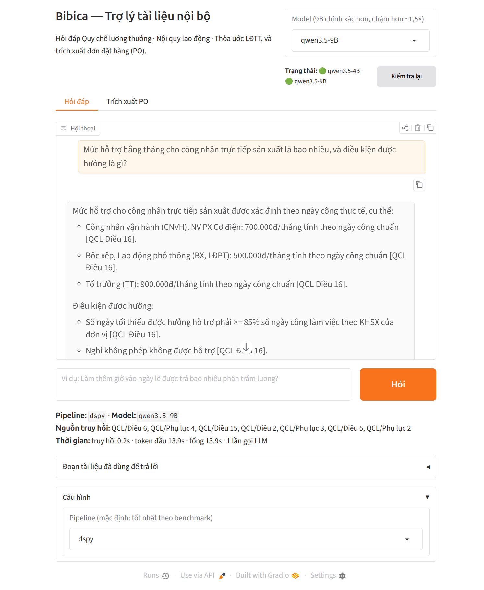
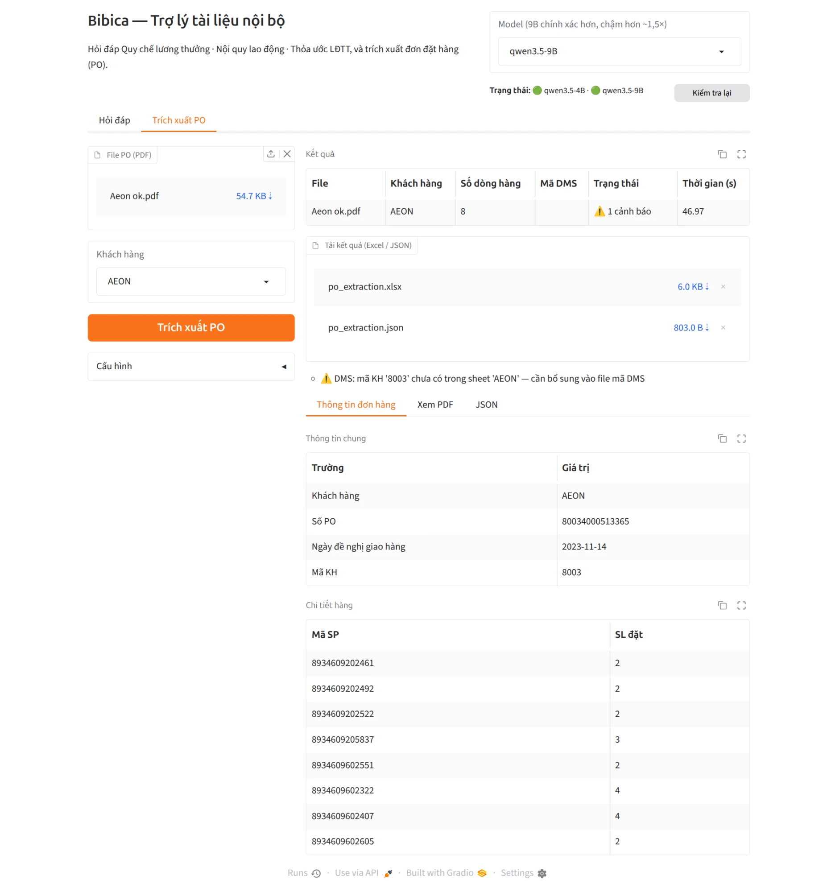

# Bibica RAG — Trợ lý tài liệu nội bộ

Bibica RAG là một ứng dụng web chạy **hoàn toàn trên máy nội bộ** (mô hình Qwen3.5 chạy bằng llama.cpp), gồm hai chức năng:

1. **Hỏi đáp tài liệu nhân sự** — trả lời câu hỏi của nhân viên/HR dựa trên *Quy chế lương thưởng*, *Nội quy lao động* và
   *Thỏa ước lao động tập thể* của Bibica, có trích dẫn điều khoản (ví dụ `[QCL Điều 16]`) và biết từ chối khi tài liệu không có thông tin.
2. **Trích xuất đơn đặt hàng (PO)** — đọc PO dạng PDF của các siêu thị và trả về đúng những trường Bibica cần cho từng
   khách hàng (số PO, ngày đề nghị giao hàng, mã KH, danh sách mã SP + số lượng), kèm **mã DMS** của khách hàng, xuất ra Excel/JSON
   để bộ phận bán hàng không phải nhập tay vào DMS.

Dự án cũng chứa một **bộ benchmark các kỹ thuật RAG** (chunking, embedding, reranking, LLM-wiki, CAG và các framework
LangGraph / LangChain / LlamaIndex / Haystack / DSPy) để chọn pipeline hỏi đáp tốt nhất cho tiếng Việt.

## Giao diện

### Hỏi đáp



Nhập câu hỏi, hệ thống truy hồi các đoạn liên quan trong tài liệu rồi để LLM trả lời có trích dẫn nguồn. Dưới câu trả lời hiển thị
pipeline và model đang dùng, các nguồn truy hồi, thời gian (truy hồi, token đầu, tổng) và số lần gọi LLM; mục **Đoạn tài liệu đã dùng để trả lời**
cho phép đối chiếu với văn bản gốc. Pipeline mặc định (`dspy`) là cấu hình tốt nhất theo benchmark và có thể đổi trong **Cấu hình**.

### Trích xuất PO



Tải lên file PO (PDF), chọn khách hàng (hoặc để hệ thống tự nhận diện) rồi bấm **Trích xuất PO**. Kết quả gồm bảng tóm tắt,
thông tin chung, chi tiết từng dòng hàng, bản xem PDF/JSON và file tải về (Excel / JSON). Các **cảnh báo** tự kiểm tra
(ví dụ mã KH chưa có trong file mã DMS, sai chữ số kiểm tra EAN-13, dòng trùng) được hiển thị để người dùng soát lại trước khi nhập vào DMS.

Ở góc trên của cả hai tab có ô chọn **Model** (Qwen3.5-4B nhanh hơn, Qwen3.5-9B chính xác hơn nhưng chậm hơn khoảng 1,5 lần)
và trạng thái các server model.

## Điểm nổi bật

- **Chạy cục bộ, dữ liệu không rời khỏi công ty**: LLM/VLM local qua llama.cpp; chỉ khi chọn thì mới dùng Gemini API cho trích xuất PO.
- **Hỏi đáp có căn cứ**: trích dẫn điều/phụ lục, từ chối khi không có trong tài liệu; được đánh giá trên bộ **240 câu hỏi**
  (fact, bảng số liệu, multi-hop, liên văn bản, điều kiện, liệt kê, câu không có đáp án, diễn đạt đời thường, không dấu...).
- **So sánh công bằng nhiều kỹ thuật RAG**: bảng xếp hạng tại `results/leaderboard.csv` (báo cáo `results/report.html`). Với Qwen3.5-9B,
  top 3 theo tỷ lệ đạt là DSPy (≈78%), CAG toàn văn (≈76%) và naive RAG tối ưu (≈75%); chi tiết phương pháp chấm ở `results/judge/RUBRIC.md`.
- **Trích xuất PO theo "đúng cái Bibica cần"**: cấu hình trường riêng cho từng siêu thị (AEON, BHX, BigC, COOP, E-Mart, Lotte, MM, SATRA, VIN, LANCHI)
  trong `config/po_customers.yaml`; đối chiếu mã cửa hàng → mã DMS, không đoán khi chưa có mã.
- **Đánh giá theo chỉ số nghiệp vụ**: tỷ lệ PO không cần sửa, F1 theo dòng hàng (ghép theo mã SP), độ chính xác từng trường —
  xem `docs/PO_EXTRACTION.md`. Lưu ý: kết quả hiện có dựa trên 9 PO mẫu (mỗi siêu thị một file) nên chưa phải ước lượng thống kê.

## Cấu trúc thư mục

| Thư mục / file | Nội dung |
|---|---|
| `app.py` | Giao diện web Gradio (tab Hỏi đáp + Trích xuất PO) |
| `bibica_rag/` | Mã nguồn chính: `ingest/` (parse tài liệu), `pipelines/` (các pipeline RAG), `eval/` (đánh giá, judge), `po/` (trích xuất PO) |
| `config/`, `configs/` | Cấu hình trường PO theo khách hàng; cấu hình các giai đoạn benchmark |
| `data/` | Tài liệu đã parse, bộ câu hỏi kiểm thử, ground truth PO, PO tổng hợp để test |
| `results/` | Kết quả benchmark, bảng xếp hạng, báo cáo |
| `docs/` | Tài liệu chi tiết (`PO_EXTRACTION.md`) và ảnh minh họa |
| `scripts/` | Chạy server model (`serve.sh`), benchmark, tạo báo cáo/PO tổng hợp |
| `tests/` | Unit test và kiểm thử trên PO thật |

---

## Hướng dẫn kỹ thuật (English)

### Setup
- Python 3.12 via `uv sync`
- Put the original `.doc` files in `RAG/` (not tracked: internal documents)
- `soffice --headless --convert-to docx --outdir data/docx RAG/*.doc`
- `uv run python -m bibica_rag.ingest.parse_docx` → `data/parsed/` (Markdown + `nodes.jsonl`)

Models (`models/`) and llama.cpp binaries (`tools/`) are downloaded locally and not tracked.

### Web UI
`uv run python app.py` (http://127.0.0.1:7860) — tabs **Hỏi đáp** (RAG pipelines from the benchmark, chosen under
**Cấu hình**) and **Trích xuất PO**. The local VLM is started with `scripts/serve.sh 4B` (:8080); start
`scripts/serve.sh 9B 8082` as well to switch to Qwen3.5-9B with the **Model** dropdown at the top (used by both tabs;
PO only with provider `local`, set under **Cấu hình**). Other endpoints: `LLM_ENDPOINTS="name=url,..."`.

### PO extraction (`bibica_rag/po/`)
Retailer purchase order PDF → exactly the fields Bibica needs for that retailer (from the Excel in `PO Extraction/`),
plus the DMS customer code. Details, evaluation method and current results: `docs/PO_EXTRACTION.md`.

```bash
scripts/serve.sh 4B              # local Qwen3.5-4B VLM on :8080 (default); or BIBICA_PO_PROVIDER=gemini GEMINI_API_KEY=...
uv run python -m bibica_rag.po.extract "PO Extraction/" --out results/po
uv run python -m bibica_rag.po.evaluate score --pred results/po --gt data/po_gt     # -> results/po_eval/report.md
uv run pytest tests/                                     # unit tests + model-free checks on the real samples
BIBICA_LIVE=1 uv run pytest tests/test_po_live.py -s     # accuracy gate with the real VLM
```

### Stage C: Qwen3.5-9B
`scripts/bench_9b.sh` re-runs the Stage-B top pipelines (CAG, DSPy, naive-best-s2b, naive-best) with the 9B model,
unattended and resumable, and packs everything into `results/stageC_9B.tar.gz` for judging.
